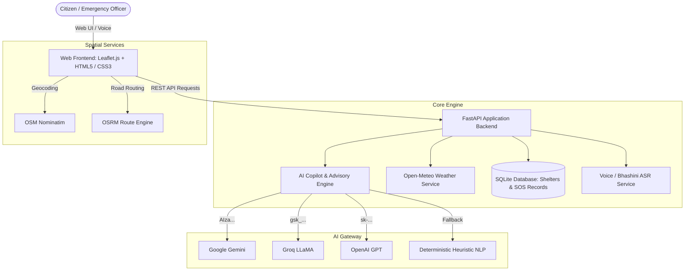

# ResQ-Odisha: Universal AI Multi-Hazard Command & Citizen Safety Advisory System

[](https://opensource.org/licenses/MIT)
[](https://www.python.org/)
[](https://fastapi.tiangolo.com/)
[](https://leafletjs.com/)

**ResQ-Odisha** is a production-grade, single-command deployable multi-hazard disaster response platform specifically engineered for Odisha's vulnerability to Bay of Bengal cyclones, Mahanadi and Baitarani riverine delta floods, coastal storm surges, and lightning hazards.

---

## 📌 Table of Contents
- [Key Features](#-key-features)
- [System Architecture](#-system-architecture)
- [Directory Structure](#-directory-structure)
- [Getting Started](#-getting-started)
  - [Prerequisites](#prerequisites)
  - [Installation](#installation)
  - [Environment Configuration](#environment-configuration)
  - [Running the Application](#running-the-application)
- [API Reference](#-api-reference)
- [Security & Compliance](#-security--compliance)
- [Contributing](#-contributing)
- [License](#-license)

---

## 🚀 Key Features

### 1. 🧠 Omnipresent ResQ-AI Universal Copilot
* **Zero Client-Side Configuration**: A single backend-managed key (`AI_API_KEY`) powers the entire application.
* **Auto-Detecting Multi-Provider LLM Gateway**:
  * `AIza...` &rarr; **Google Gemini API** (`gemini-2.5-flash`)
  * `gsk_...` &rarr; **Groq API** (`llama-3.3-70b-versatile`)
  * `sk-...` &rarr; **OpenAI API** (`gpt-4o-mini`)
  * `hf_...` &rarr; **Hugging Face Inference API**
  * **Resilient Offline Fallback**: High-fidelity deterministic heuristic reasoning engine if no key is configured or network is unavailable.
* **Bilingual Support**: Delivers structured intelligence in English and authentic **ଓଡ଼ିଆ (Odia)** script.
* **Automated Emergency Dispatch**: Classifies distress reports, matches nearest available cyclone shelter, and logs emergency response records.

### 2. 🛣️ Real Road Routing & Geocoding (Zero Mock Routes)
* **OSRM Routing Engine**: Evacuation routes follow real highways, bridges, and coastal roads in Odisha using the Open Source Routing Machine (`https://router.project-osrm.org`), providing real driving distance (km) and estimated travel time (ETA in minutes).
* **OpenStreetMap Nominatim Geocoding**: Resolves coordinate clicks or GPS fixes into real Odisha village, street, and district locations.

### 3. 🌧️ Real-Time Weather Sync vs Simulation Mode
* **Live Weather Mode (`POST /api/weather/sync-live`)**: Fetches real-time precipitation, wind velocity, and gusts from **Open-Meteo** across 6 coastal districts (Puri, Jagatsinghpur, Kendrapara, Cuttack, Khordha, Ganjam).
* **Simulated Cyclone Mode (`POST /api/weather/simulate-cyclone`)**: One-click navbar button toggles between live baseline weather and an active high-severity Bay of Bengal cyclone landfall scenario for drills and demonstrations.

### 4. 🎤 Voice Recognition (Speech-to-Text)
* Built-in Web Speech API voice capture for prompts in English (`en-IN`) and Odia (`or-IN`).
* Extensible integration pipeline for **Bhashini ULCA** Odia ASR.

### 5. 🏥 Multipurpose Cyclone Shelter & Emergency Fleet Tracking
* Real-time capacity utilization tracking for OSDMA Multipurpose Cyclone Shelters (MCS).
* Direct readiness dispatch status for **ODRAF (1070)**, **NDRF (1078)**, **108 Medical Ambulance (108)**, **Fire & Rescue (112)**, and **Coast Guard (1554)**.

---

## 🏗️ System Architecture



---

## 📁 Directory Structure

```text
resq_odisha/
├── app/
│   ├── __init__.py
│   ├── config.py            # AI Key detection & environment loader
│   ├── main.py              # FastAPI app, lifespan DB init, Copilot & Weather endpoints
│   ├── database.py          # SQLite schema, Haversine spatial math, auto-seeding
│   ├── ai_copilot.py        # Universal Copilot reasoning & LLM integration
│   ├── ml_engine.py         # Hugging Face pipelines + deterministic fallback classifier
│   ├── advisory_engine.py   # Bilingual (English + Odia) OSDMA safety SOPs
│   ├── weather_intel.py     # Weather intelligence & marine forecast analyzer
│   ├── weather_service.py   # Live Open-Meteo fetcher & district sync engine
│   └── bhashini_service.py  # Bhashini ULCA Odia ASR integration
├── static/
│   ├── index.html           # Unified AI Command Center & Citizen Safety Hub
│   ├── app.js               # OSRM road routing, Nominatim geocoding, voice recognition
│   ├── styles.css           # Glassmorphism styling, responsive UI, Leaflet markers
│   └── vendor/              # Bundled Leaflet scripts & stylesheets for offline resilience
├── .env.example             # Safe template for environment configuration
├── requirements.txt         # Python package dependencies
├── .gitignore               # Git exclusions (credentials, databases, caches)
└── README.md                # Project documentation
```

---

## 🛠️ Getting Started

### Prerequisites
* Python 3.10 or higher
* `pip` package manager
* Modern web browser with Web Speech API support (Google Chrome, Edge, etc.)

### Installation
1. Clone the repository:
   ```bash
   git clone https://github.com/SASWATDAS406/ResQ__Odisha.git
   cd ResQ__Odisha
   ```

2. Create and activate a virtual environment (recommended):
   ```bash
   # Windows
   python -m venv venv
   .\venv\Scripts\activate

   # Linux / macOS
   python3 -m venv venv
   source venv/bin/activate
   ```

3. Install required dependencies:
   ```bash
   pip install -r requirements.txt
   ```

### Environment Configuration
Copy the sample environment file:
```bash
cp .env.example .env
```
Open `.env` and set your preferred AI provider key (Gemini, Groq, OpenAI, or Hugging Face):
```env
AI_API_KEY=your_api_key_here
```
*(If no key is configured, the system operates seamlessly using its built-in offline NLP engine).*

### Running the Application
Launch the server using `uvicorn`:
```bash
python -m uvicorn app.main:app --host 127.0.0.1 --port 8000 --reload
```

Open your browser and navigate to:
**`http://localhost:8000/`**

---

## 📡 API Reference

| Method | Endpoint | Description |
|---|---|---|
| `GET` | `/` | Serves the Command Center & Citizen Safety Hub web UI |
| `POST` | `/api/ai/copilot` | Universal AI Copilot for chat, weather, first aid, shelter lookup, and automated SOS |
| `POST` | `/api/weather/sync-live` | Syncs real-time Open-Meteo weather for all 6 Odisha districts |
| `POST` | `/api/weather/simulate-cyclone` | Activates severe Bay of Bengal cyclone landfall scenario |
| `GET` | `/api/hazards` | Returns district hazard warning zones with rainfall and wind telemetry |
| `GET` | `/api/shelters` | Returns all cyclone shelters with live available bed capacity |
| `POST` | `/api/sos` | Submits emergency SOS report, triggers AI triage, and assigns nearest shelter |
| `GET` | `/api/stats` | Operational telemetry and AI gateway status |
| `POST` | `/api/ai/asr` | Automatic Speech Recognition for Odia (`or`) and English (`en`) |

---

## 🔒 Security & Compliance

* **Zero Hardcoded Secrets**: All API keys and secrets are loaded strictly through environment variables.
* **GitHub Policy Compliance**: No sensitive personal information, proprietary keys, or internal tokens are tracked.
* **Disclaimer**: This software is intended for disaster response simulation, research, and hackathon demonstrations. For real-life emergencies, contact local response authorities immediately via emergency numbers **112**, **1070** (OSDMA), or **108** (Ambulance).

---

## 🤝 Contributing

Contributions are welcome! Please follow these steps:
1. Fork the repository.
2. Create your feature branch (`git checkout -b feature/amazing-feature`).
3. Commit your changes (`git commit -m 'feat: add amazing feature'`).
4. Push to the branch (`git push origin feature/amazing-feature`).
5. Open a Pull Request.

---

## 📄 License

This project is licensed under the MIT License - see the LICENSE file for details.
